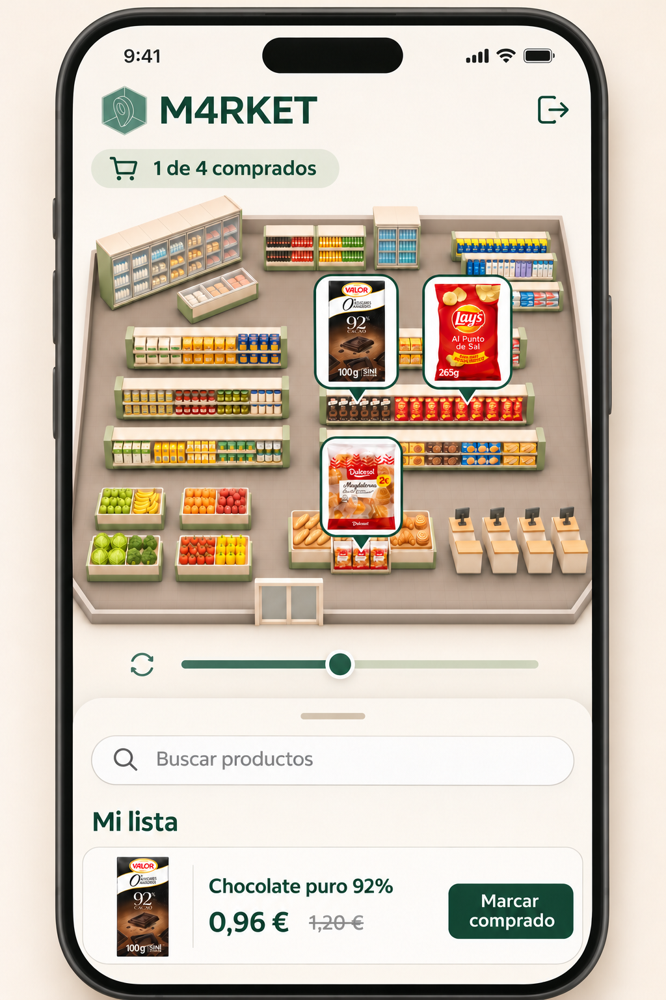
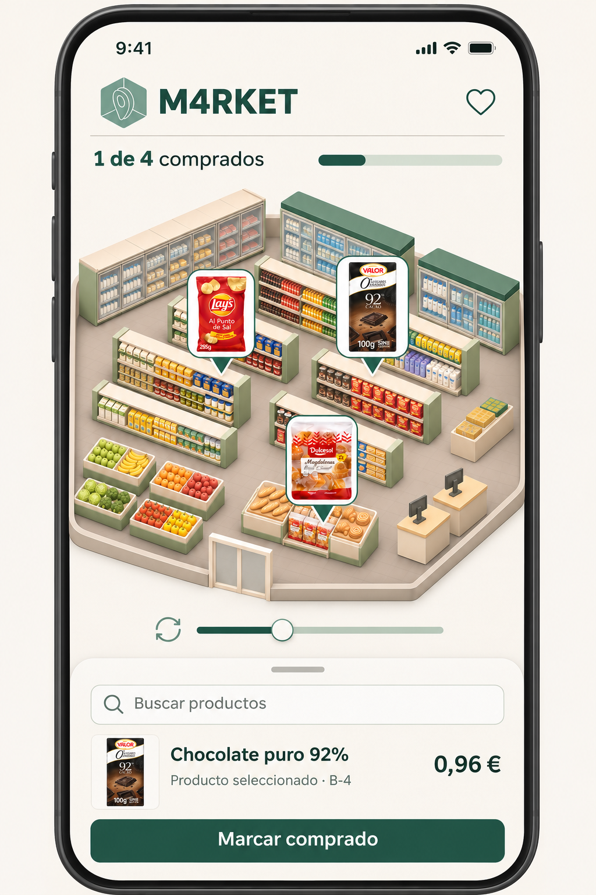
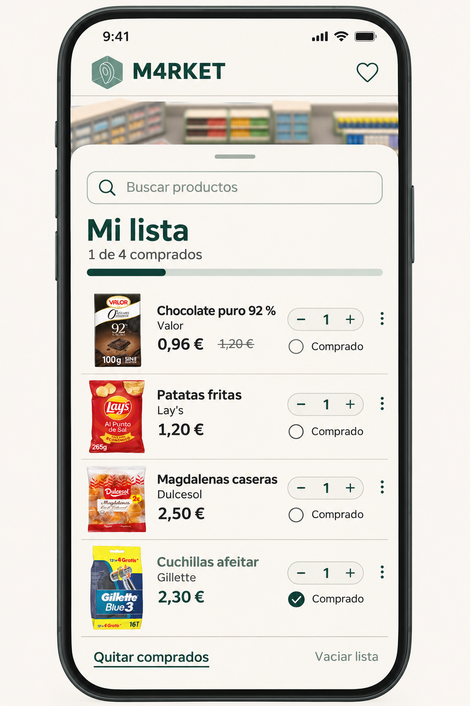
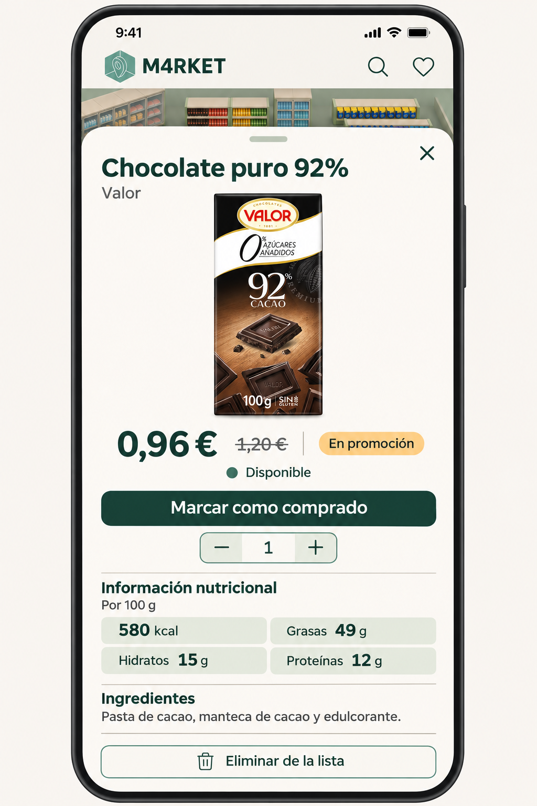
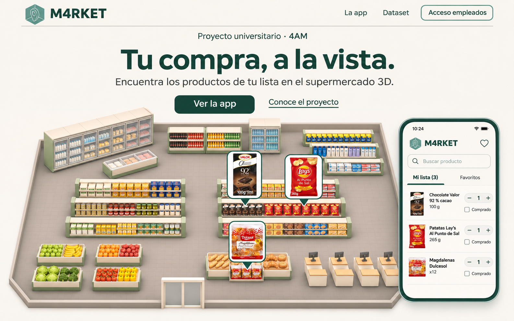
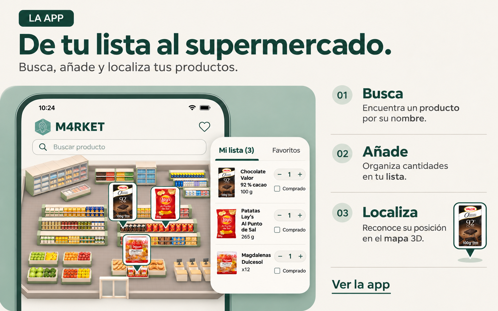
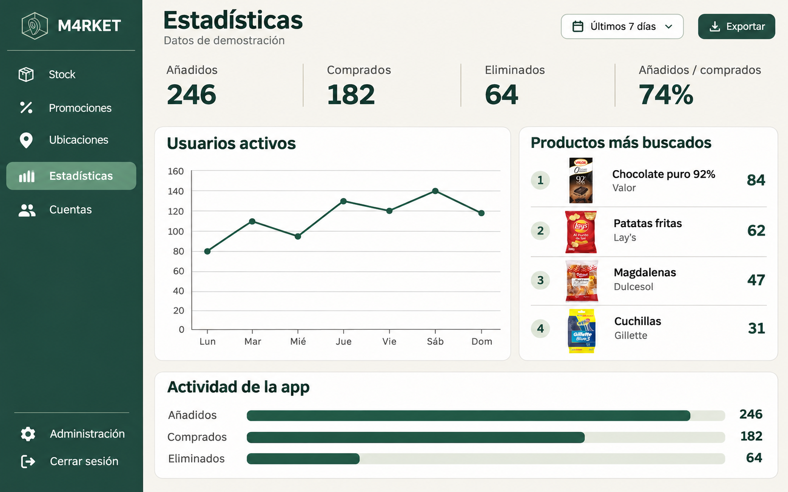
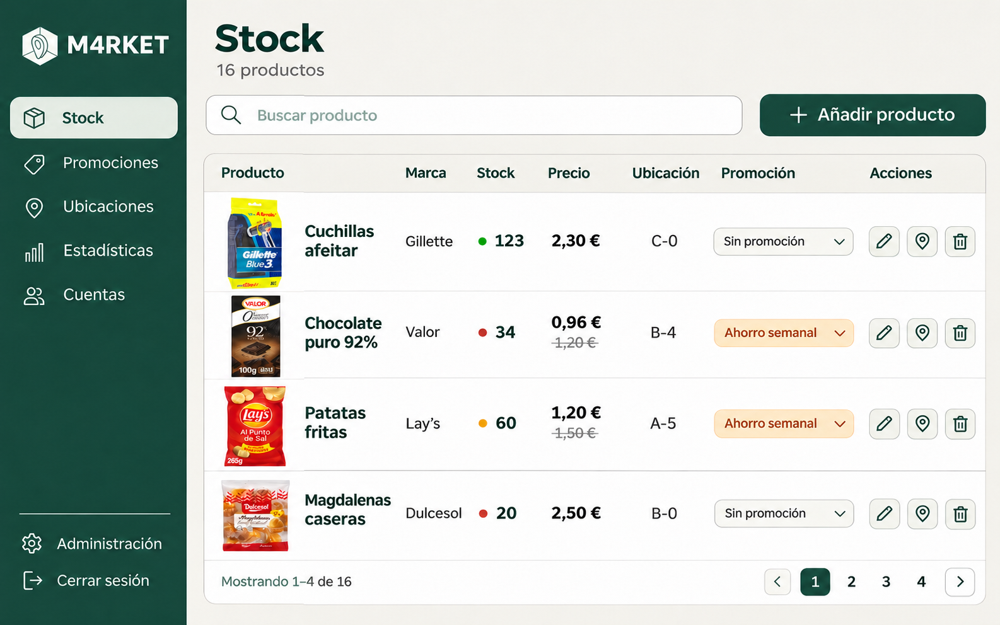

# Bocetos de rediseño de M4RKET

27/11/2026 · Referencias visuales para revisar · Ocho PNG independientes.

Son propuestas de aspecto sobre las funciones existentes. No se han cambiado la API, la base de datos, Angular, Ionic ni el motor. Las imágenes no son capturas de una implementación terminada.

## Galería

| Boceto | Abrir imagen | Qué permite comparar |
| --- | --- | --- |
| 01 · App: mapa 3D | [Mapa 3D](./01-app-mapa-3d.png) | Escena con más protagonismo, estanterías abastecidas, fotos en los pines y panel inferior legible. |
| 02 · App: acabado vectorial | [Alternativa del mapa](./02-app-mapa-acabado-vectorial.png) | Volumen 3D con caras sólidas y sombreado contenido, inspirado en C. |
| 03 · App: lista | [Lista de compra](./03-app-lista.png) | Fotos, cantidades y estado comprado ordenados en un panel desplegado. |
| 04 · App: producto | [Ficha de producto](./04-app-ficha-producto.png) | Jerarquía de foto, precio, acción y datos nutricionales. |
| 05 · Web: inicio | [Cabecera y presentación](./05-web-inicio.png) | Mensaje breve, supermercado como imagen principal y acceso de empleados diferenciado. |
| 06 · Web: funcionamiento | [Sección explicativa](./06-web-como-funciona.png) | Presentación visual de buscar, añadir y localizar. |
| 07 · Administración: estadísticas | [Estadísticas](./07-admin-estadisticas.png) | Lectura de métricas existentes, actividad y productos más buscados. |
| 08 · Administración: stock | [Stock](./08-admin-stock.png) | Tabla con fotos, cantidades, precios, ubicación y acciones existentes. |

La web se representa mediante dos secciones horizontales separadas. La app y la administración se muestran en imágenes individuales para poder ampliar cada pantalla.

## Dirección visual

Una misma identidad para las tres superficies: marfil, verde pino, salvia y texto oscuro; tipografía sans legible; separadores finos y espacios más claros. Las fotos de producto vinculan el mapa, la lista, la ficha y el catálogo del personal. La aplicación conserva su supermercado tridimensional y el panel inferior; el acabado vectorial es una alternativa visual del volumen 3D.

Recomendaciones sencillas que ilustran los bocetos:

- App: dar más superficie al mapa, hacer reconocibles los pines por su foto y ordenar las acciones de compra alrededor del panel inferior.
- Web: explicar en la primera vista qué hace el proyecto y mostrar el propio supermercado, con un acceso de empleados claramente identificable.
- Administración: alinear fotos y cifras, reducir espacio desaprovechado de las filas y separar métricas, gráficos y listados por jerarquía.

## Origen y alcance

Preparados con criterios de **Impeccable**, **imagegen-frontend-mobile** e **imagegen-frontend-web**, y generados con la herramienta de imágenes integrada. Se usaron como referencia la app y el catálogo actuales, los bocetos 3D previamente conservados, la maqueta C y las fotografías de Valor, Lay’s, Dulcesol y Gillette del repositorio.

Las ocho entregas son imágenes PNG. El acabado de 02 se inspira en la maqueta vectorial C; su archivo es una imagen raster. Los SVG originales de C se conservan en [bocetos-mapa](../bocetos-mapa/LEEME.md).

La distribución del supermercado es conceptual: no garantiza las coordenadas de las 41 ubicaciones. Las fotos, textos, marcas y cifras pueden estar reinterpretados por la generación; los indicadores del panel son ilustrativos, no mediciones nuevas de MariaDB. Las imágenes sirven para elegir dirección visual, no como especificación exacta de datos o controles.

El alcance se limita a presentar funciones existentes. Las propuestas no incluyen rutas guiadas, GPS, pagos, reparto, chatbot ni servicios de nube. La página corporativa 4AM pendiente de recuperar no se reconstruye mediante estos bocetos. La aplicación sigue mostrando su aspecto actual.

## Vistas

### 01 · App: mapa 3D

### 02 · App: mapa con acabado vectorial

### 03 · App: lista de compra

### 04 · App: ficha de producto

### 05 · Web: inicio

### 06 · Web: funcionamiento

### 07 · Administración: estadísticas

### 08 · Administración: stock

